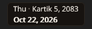

# MitiBar

MitiBar keeps today's Bikram Sambat date in a floating bar and the system tray. It opens a
month grid, day detail, a BS/AD converter and settings. It makes no network requests.

It is for people who read the Nepali date every day and do not want to open a calendar app for it.




## Install

Download the latest release from
[GitHub Releases](https://github.com/sanamhub/mitibar/releases).

| System | Package |
|---|---|
| Windows 10 and 11 | `MitiBar-<version>-windows-x64-setup.exe` (per-user, no admin) or the portable `.zip` |
| macOS 11 or later | `.dmg` with a universal `MitiBar.app` |
| Linux x86_64 | `.AppImage` or `.deb` |

On Linux, MitiBar needs a tray (StatusNotifier/AppIndicator), fontconfig, xkbcommon and D-Bus. It
uses a software renderer, so no OpenGL driver is needed.

## Build

Rust 1.98 is pinned in `rust-toolchain.toml`.

```bash
cargo run --release
```

On Linux, install the build dependencies first:

```bash
sudo apt install libxkbcommon-dev libwayland-dev libfontconfig1-dev libdbus-1-dev
```

Run the checks with:

```bash
cargo xtask ci
```

Settings live in `%APPDATA%\mitibar\settings.toml` on Windows,
`~/Library/Application Support/mitibar/settings.toml` on macOS and
`~/.config/mitibar/settings.toml` on Linux. Logs go to the matching local data folder.

## Status

0.2.0 is in development. Windows is the primary target. macOS and Linux packages are built by the
release workflow; the manual test runbook is in
[`docs/runbooks/widget-manual-test.md`](docs/runbooks/widget-manual-test.md).

## Data

MitiBar is built on the [`nepdate`](https://crates.io/crates/nepdate) and
[`nepdate-patro`](https://crates.io/crates/nepdate-patro) crates. The calendar data and the
conversion rules come from [NepDate](https://nepdate.com), maintained by Raju Prasai and Sanam
Pakuwal. The MIT licence and the data notice apply.

## License

MIT. The bundled Noto Sans and Noto Sans Devanagari fonts are under the SIL Open Font License.
Slint is used under its royalty-free licence. See [LICENSE](LICENSE).

