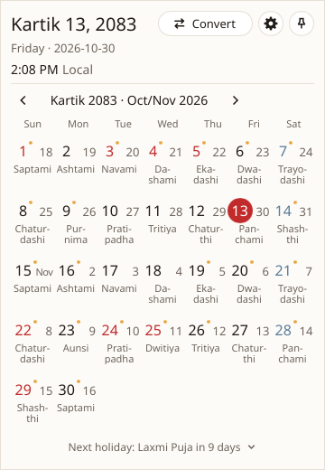
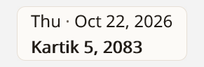

<p align="center">
  
</p>

<h1 align="center">MitiBar</h1>

<p align="center">
  The Nepali date on your desktop. Small, fast and offline, for Windows, macOS and Linux.
</p>

<p align="center">
  <a href="https://github.com/sanamhub/mitibar/actions/workflows/ci.yml"></a>
  <a href="https://github.com/sanamhub/mitibar/releases"></a>
  <a href="LICENSE"></a>
</p>

MitiBar keeps today's Bikram Sambat date in sight: in a small bar above the Windows taskbar, and
on the tray or menu bar icon on every system. One click opens the month, with the tithi under each
day, public holidays in red and the next holiday named. A converter turns BS dates into AD and back.
MitiBar makes no network connections.

It is for people who read the Nepali date every day and do not want to open a calendar for it.
More about it, with downloads for each system: **[nepdate.com/mitibar](https://nepdate.com/mitibar/)**.

<p align="center">
  <picture>
    <source media="(prefers-color-scheme: dark)" srcset="docs/screenshots/popup-dark.png">
    
  </picture>
  &nbsp;
  <picture>
    <source media="(prefers-color-scheme: dark)" srcset="docs/screenshots/bar-dark.png">
    
  </picture>
</p>

## What it does

- Today's BS date on the tray icon, and on Windows a two-line bar you can drag anywhere. You pick
  what each line shows (weekday, BS or AD date, time, tithi, holiday) or start from a preset.
- The month view with tithi, holidays and events; year and decade views to jump far.
- A BS and AD converter, and the number of days between two dates.
- English or Nepali, light or dark or the system's theme, and a global shortcut (Win+Shift+N).
- Starts with your computer if you want it to, and hides the bar over full-screen apps.

## Install

Download the latest release from
[GitHub Releases](https://github.com/sanamhub/mitibar/releases) or
[nepdate.com/mitibar](https://nepdate.com/mitibar/#download).

| System | Package |
|---|---|
| Windows 10 and 11 | `mitibar_<version>_x64-setup.exe` or `_arm64-setup.exe` (per user, no admin), or the portable `.zip` |
| macOS 11 or later | `MitiBar-<version>.dmg` with a universal `MitiBar.app` |
| Linux x86_64 | `.AppImage` or `.deb` |

Each release has a `SHA256SUMS` file. Check a download against it before you run it, for example
`certutil -hashfile mitibar_<version>_x64-setup.exe SHA256` on Windows.

On Linux, MitiBar needs a tray (StatusNotifier/AppIndicator), fontconfig, xkbcommon and D-Bus. It
uses a software renderer, so no OpenGL driver is needed.

## Build

Rust 1.98 is pinned in `rust-toolchain.toml`.

```bash
cargo run --release
```

On Linux, install the build dependencies first:

```bash
sudo apt install libxkbcommon-dev libwayland-dev libfontconfig1-dev libdbus-1-dev
```

Run the checks with:

```bash
cargo xtask ci
```

Settings live in `%APPDATA%\mitibar\settings.toml` on Windows,
`~/Library/Application Support/mitibar/settings.toml` on macOS and
`~/.config/mitibar/settings.toml` on Linux. Logs go to the matching local data folder.

## Status

MitiBar is in beta on the way to 1.0. Windows is the primary target. macOS and Linux packages are built by the
release workflow; the manual test runbook is in
[`docs/runbooks/widget-manual-test.md`](docs/runbooks/widget-manual-test.md).

## Data

MitiBar is built on the [`nepdate`](https://crates.io/crates/nepdate) and
[`nepdate-patro`](https://crates.io/crates/nepdate-patro) crates. The calendar data and the
conversion rules come from [NepDate](https://nepdate.com), maintained by Raju Prasai and Sanam
Pakuwal. The MIT licence and the data notice apply.

## Code signing policy

Windows releases will be signed with free code signing provided by
[SignPath.io](https://about.signpath.io), with a certificate issued by the
[SignPath Foundation](https://signpath.org). Until that certificate is issued, each release lists
the SHA-256 sum of every file.

- Committers and reviewers: [sanamhub](https://github.com/sanamhub)
- Approvers: [sanamhub](https://github.com/sanamhub)

Every signed file is built by the release workflow in this repository from a tagged commit, and
each signing request is approved by hand.

Privacy: MitiBar makes no network connections. It does not send any information to other
computers, and it stores only its settings file and a log file on your own machine.

## License

MIT. The bundled Noto Sans and Noto Sans Devanagari fonts are under the SIL Open Font License.
Slint is used under its royalty-free licence. See [LICENSE](LICENSE).

